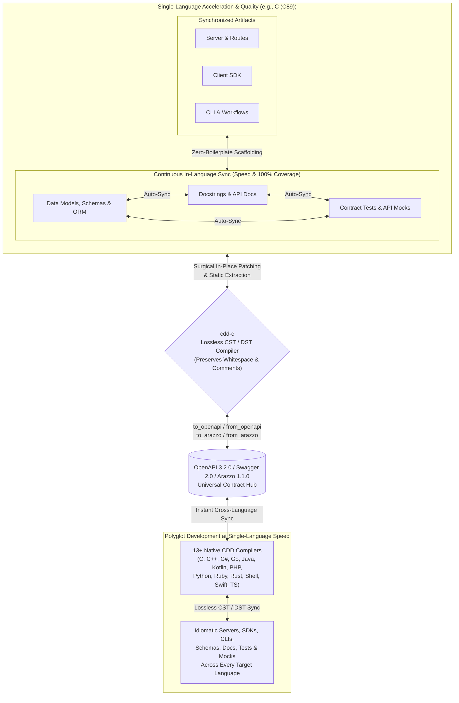

cdd-c: C (C89) ⇄ OpenAPI
========================

[](https://opensource.org/licenses/Apache-2.0)
[](https://offscale.io/wasm_web_demo)
[](https://github.com/SamuelMarks/cdd-c/actions)
[](#)
[](#)

**cdd-c** compiles **[OpenAPI](https://spec.openapis.org/oas/latest.html) / [Swagger](https://spec.openapis.org/oas/v2.0.html) / [Arazzo](https://spec.openapis.org/arazzo/latest.html)** to and from **C (C89)** (servers, client SDKs, CLIs, database schemas, tests, mocks, and docs), updating your existing code in-place without overwriting your edits.

**Compiler Driven Development (CDD)** is a software engineering methodology that uses a suite of standalone, lossless compilers to synchronize API specifications, server implementations, client SDKs, command-line tooling, workflow orchestrators, tests, and documentation.

Unlike traditional code generators that treat outputs as disposable or read-only, Compiler Driven Development provides a **complete, standalone compiler** (exposed as both a CLI and a programmatic SDK) written natively in each supported language. Where conventional compilers rely solely on an Abstract Syntax Tree (AST) that discards formatting and comments, CDD compilers operate on a **Concrete Syntax Tree (CST)** or **Decorated Syntax Tree (DST)**. This guarantees **lossless conversion**—preserving exact whitespace, indentation, inline comments, block comments, and docstrings—allowing true bidirectional synchronization between hand-edited `C (C89)` source code and [OpenAPI 3.2.0](https://spec.openapis.org/oas/v3.2.0.html), [Swagger 2.0](https://spec.openapis.org/oas/v2.0.html), and [Arazzo 1.1.0](https://spec.openapis.org/arazzo/v1.1.0.html) specifications.

---

## Why Compiler Driven Development?

By replacing one-way templates and manual boilerplate with lossless CST/DST compilers, Compiler Driven Development transforms the engineering lifecycle across four dimensions:

- **Development Speed**: Eliminate manual boilerplate across servers, client SDKs, CLIs, database models, workflow runners, and mock servers. Start from an [OpenAPI](https://spec.openapis.org/oas/latest.html) or [Arazzo](https://spec.openapis.org/arazzo/latest.html) specification to scaffold an entire installable project (complete with package manifests and CI workflows), or write code first in `C (C89)` and extract the specification automatically. When requirements change, update whichever representation is most convenient and synchronize the rest immediately.
- **Development Consistency**: Every data model, route handler, CLI flag, ORM entity, workflow step, and API contract is derived from and validated against the same semantic representation. Architectural drift between backend routes, frontend clients, and published specifications becomes structurally impossible.
- **Development Quality**: Keeping tests and documentation in lockstep with implementation code is automated rather than an afterthought. Because the compiler parses and emits docstrings, type signatures, API mocks, and contract test suites alongside your business logic, maintaining **100% documentation coverage and 100% test coverage** becomes a natural byproduct of compilation rather than a manual chore.
- **Polyglot Development**: Seamlessly bridge **13+ programming languages** (C, C++, C#, Go, Java, Kotlin, PHP, Python, Ruby, Rust, POSIX Shell, Swift, and TypeScript) to and from [OpenAPI](https://spec.openapis.org/oas/latest.html) and [Arazzo](https://spec.openapis.org/arazzo/latest.html) specifications. Any codebase in any supported language can be reverse-compiled into OpenAPI/Arazzo and immediately compiled forward into idiomatic, human-editable code across every other language in the suite. And being an open-source methodology—rather than a proprietary trade secret—new languages can be added by implementing new compilers that follow the CDD approach (see [cdd-spec-conformance](https://github.com/SamuelMarks/cdd-spec-conformance) for tooling to facilitate).

---

## The Standalone Compiler Architecture and Lossless Conversion

Traditional code generation tools rely on destructive templating: if you regenerate your project from an updated specification, your custom implementation logic, formatting, and comments are overwritten.

Each Compiler Driven Development toolchain is written natively in its target language, compiles both to native binaries and to **WebAssembly (WASM/WASI)**, and implements a full lexer, parser, semantic differ, and code emitter backed by Concrete Syntax Tree (CST) and Decorated Syntax Tree (DST) representations:

- **Beyond AST to CST/DST**: A standard Abstract Syntax Tree (AST) captures program semantics while stripping away "trivia" (whitespace, blank lines, and comments). By pairing structural AST semantics with a Concrete Syntax Tree (CST) or Decorated Syntax Tree (DST) that attaches trivia and structured documentation directly to syntax nodes, the compiler preserves 100% of your source formatting and comments.
- **Zero-Destruction Guarantee**: Every part of the generated codebase is designed to be edited by humans. You can open generated routing files, data models, database entities, workflow runners, tests, and CLI commands, format them to your preferences, add inline comments, and inject custom business logic.
- **When your specification changes**: The CDD compiler parses your existing source files into a CST/DST, computes a semantic diff against the updated [OpenAPI](https://spec.openapis.org/oas/latest.html) or [Arazzo](https://spec.openapis.org/arazzo/latest.html) specification, and surgically patches in new endpoints, workflows, parameters, or fields without disturbing your custom logic, comments, or whitespace.
- **When your codebase changes**: The compiler statically analyzes your updated source code, routes, workflows, tests, and docstrings—without unsafe dynamic code execution or reflection—to extract a 100% compliant, authoritative [OpenAPI](https://spec.openapis.org/oas/latest.html) or [Arazzo](https://spec.openapis.org/arazzo/latest.html) specification.

---

## The Bidirectional Synchronization Loop



The Compiler Driven Development lifecycle delivers compounding returns in both single-language and polyglot environments:
1. **Single-Language Speed**: Edit whichever artifact is most convenient—models/schemas, route handlers, docstrings, or tests—and let `cdd-c` surgically synchronize the rest in-place without overwriting your custom logic, comments, or whitespace.
2. **Single-Language Quality**: Because schemas, documentation, contract tests, and mocks are continuously cross-compiled rather than manually maintained, **100% doc coverage and 100% test coverage** are enforced automatically on every sync.
3. **Polyglot Development at Single-Language Speed**: Extracting an authoritative [OpenAPI](https://spec.openapis.org/oas/latest.html) or [Arazzo](https://spec.openapis.org/arazzo/latest.html) contract from one language immediately drives lossless forward-compilation across all 13+ supported languages—making multi-language SDK, CLI, and service maintenance just as fast as working in a single codebase.

---

## Core Capabilities Shared Across All CDD Compilers

Every `cdd-*` repository in the suite implements the same foundational feature set:

- **Bidirectional OpenAPI 3.2.0 & Swagger 2.0 Compilation**:
  - `from_openapi`: Generate idiomatic `C (C89)` Client SDKs (`to_sdk`), Client CLIs (`to_sdk_cli`), and Server stubs/routers (`to_server`) from a single specification (`-i`) or a batch directory of specifications (`--input-dir`). Automatically upgrades legacy Swagger 2.0 and OpenAPI 3.0/3.1 specifications to OpenAPI 3.2.0.
  - `to_openapi`: Statically parse existing `C (C89)` source files or directories to extract a compliant OpenAPI 3.2.0 specification.
- **Bidirectional Arazzo 1.1.0 Workflow Orchestration**:
  - `from_arazzo`: Compile multi-step [Arazzo 1.1.0](https://spec.openapis.org/arazzo/v1.1.0.html) workflow specifications (including runtime expressions, step DAGs, criterion evaluations, and failure/success actions) into `C (C89)` SDK workflow orchestrators (`to_sdk`), CLI workflow runners (`to_sdk_cli`), and Server/E2E workflow test suites (`to_server`).
  - `to_arazzo`: Reverse-parse `C (C89)` workflow orchestrators, CLI scripts, or E2E test suites back into an authoritative Arazzo 1.1.0 document.
- **In-Place Codebase Synchronization (`sync`)**:
  - Synchronize data models, ORM schemas, route handlers, docstrings, contract tests, mocks, and specifications in-place using lossless CST/DST patching.
- **Documentation Code-Snippet Generation (`to_docs_json`)**:
  - Emit a structured JSON documentation payload containing idiomatic `C (C89)` request/workflow code snippets for every operation in an OpenAPI specification (with `--no-imports` and `--no-wrapping` options for embedding in documentation portals).
- **Composable Contract Tests, Mocks, CI, and Package Scaffolding**:
  - By default, `from_openapi` and `from_arazzo` scaffold complete, installable `C (C89)` packages and `.github/workflows/ci.yml` pipelines (configurable via `--no-installable-package` and `--no-github-actions`), and generate contract test suites and API mocks/fakes via `--tests`.
- **Model Context Protocol (`mcp`) & JSON-RPC (`serve_json_rpc`)**:
  - Run `cdd-c mcp` to expose the compiler over stdio as an [MCP](https://modelcontextprotocol.io/) server for AI assistants and IDEs, or pass `--mcp` during generation to emit MCP tool/resource adapters directly inside generated SDKs and servers.
  - Run `cdd-c serve_json_rpc` to expose the compiler's full API over JSON-RPC 2.0 (`--port`, `--listen`).
- **Native CLI, Programmatic SDK, and WebAssembly (WASM/WASI)**:
  - Use `cdd-c` from the command line, import its programmatic SDK directly into `C (C89)` applications, or run it in the browser and WASI runtimes via its WebAssembly build (see [WASM.md](WASM.md)).

---

## The Global Polyglot Ecosystem

Every supported language operates on the same core Compiler Driven Development principles and is powered by a dedicated, native compiler tailored to that language's syntax tree, idioms, and package manager.

All implementations expose a standardized command-line interface (`cdd-c <subcommand>`) and programmatic SDK.

| Repository | Language | Targets (`to_sdk`; `to_sdk_cli`; `to_server`) | Special Features Beyond Common Subset | Standards | CI Status |
|---|---|---|---|---|---|
| [`cdd-c`](https://github.com/SamuelMarks/cdd-c) | C (C89) | Client; Client CLI; Server | 42-Language FFI Generator (`bind`); GNU-to-C89 AST Lowering; Safe CRT & Memory Security Auditor; `c-orm` Migrations | [Arazzo 1.1.0](https://spec.openapis.org/arazzo/v1.1.0.html); [Swagger 2.0](https://spec.openapis.org/oas/v2.0.html); [OpenAPI 3.2.0](https://spec.openapis.org/oas/v3.2.0.html); [MCP](https://modelcontextprotocol.io/) | [](https://github.com/SamuelMarks/cdd-c/actions/workflows/ci.yml) |
| [`cdd-cpp`](https://github.com/SamuelMarks/cdd-cpp) | C++ | Client; Client CLI; Server | [Google Discovery](https://developers.google.com/discovery) (`from_google_discovery`); PostgreSQL `libpq` ORM & Faker Support | [Google Discovery](https://developers.google.com/discovery); [Arazzo 1.1.0](https://spec.openapis.org/arazzo/v1.1.0.html); [Swagger 2.0](https://spec.openapis.org/oas/v2.0.html); [OpenAPI 3.2.0](https://spec.openapis.org/oas/v3.2.0.html); [MCP](https://modelcontextprotocol.io/) | [](https://github.com/SamuelMarks/cdd-cpp/actions/workflows/ci.yml) |
| [`cdd-csharp`](https://github.com/SamuelMarks/cdd-csharp) | C# | Client; Client CLI; Server | CLR & Roslyn CST/DST Trivia-Preserving Sync; Entity Framework & Minimal API Targets | [Arazzo 1.1.0](https://spec.openapis.org/arazzo/v1.1.0.html); [Swagger 2.0](https://spec.openapis.org/oas/v2.0.html); [OpenAPI 3.2.0](https://spec.openapis.org/oas/v3.2.0.html); [MCP](https://modelcontextprotocol.io/) | [](https://github.com/SamuelMarks/cdd-csharp/actions/workflows/ci.yml) |
| [`cdd-go`](https://github.com/SamuelMarks/cdd-go) | Go | Client; Client CLI; Server | Go `dst`/`ast` Surgical Patching; Multi-Source Truth Sync (`code` ⇄ `openapi`) | [Arazzo 1.1.0](https://spec.openapis.org/arazzo/v1.1.0.html); [Swagger 2.0](https://spec.openapis.org/oas/v2.0.html); [OpenAPI 3.2.0](https://spec.openapis.org/oas/v3.2.0.html); [MCP](https://modelcontextprotocol.io/) | [](https://github.com/SamuelMarks/cdd-go/actions/workflows/ci.yml) |
| [`cdd-java`](https://github.com/SamuelMarks/cdd-java) | Java | Client; Client CLI; Server | JavaParser CST Lexical Preservation; WASI JSON-RPC Mode; In-Memory Compiler Pipeline | [Arazzo 1.1.0](https://spec.openapis.org/arazzo/v1.1.0.html); [Swagger 2.0](https://spec.openapis.org/oas/v2.0.html); [OpenAPI 3.2.0](https://spec.openapis.org/oas/v3.2.0.html); [MCP](https://modelcontextprotocol.io/) | [](https://github.com/SamuelMarks/cdd-java/actions/workflows/ci.yml) |
| [`cdd-kotlin`](https://github.com/offscale/cdd-kotlin) | Kotlin (Ktor Multiplatform) | Client; Client CLI; Server | Multiplatform Auto-Admin UI; Ephemeral & Seeded Mock Server Modes; Webhook Triggers | [Arazzo 1.1.0](https://spec.openapis.org/arazzo/v1.1.0.html); [Swagger 2.0](https://spec.openapis.org/oas/v2.0.html); [OpenAPI 3.2.0](https://spec.openapis.org/oas/v3.2.0.html); [MCP](https://modelcontextprotocol.io/) | [](https://github.com/offscale/cdd-kotlin/actions/workflows/ci.yml) |
| [`cdd-php`](https://github.com/SamuelMarks/cdd-php) | PHP | Client; Client CLI; Server | Multi-Tiered DAO (`StubDao` / `ConcreteDao`); Ephemeral & Faker-Seeded SQLite Server Modes | [Arazzo 1.1.0](https://spec.openapis.org/arazzo/v1.1.0.html); [Swagger 2.0](https://spec.openapis.org/oas/v2.0.html); [OpenAPI 3.2.0](https://spec.openapis.org/oas/v3.2.0.html); [MCP](https://modelcontextprotocol.io/) | [](https://github.com/SamuelMarks/cdd-php/actions/workflows/ci.yml) |
| [`cdd-python`](https://github.com/offscale/cdd-python) | Python | N/A (server building blocks) | CLI ⇄ SQLAlchemy ⇄ Pydantic ⇄ Docs ⇄ JSON Schema | N/A | [](https://github.com/offscale/cdd-python/actions) |
| [`cdd-python-all`](https://github.com/offscale/cdd-python-all) | Python | Client; Client CLI; Server | `LibCST` Lossless Sync; Multi-Truth Sync (`class`, `sqlalchemy`, `function`, `openapi`); FastAPI + SQLAlchemy | [Arazzo 1.1.0](https://spec.openapis.org/arazzo/v1.1.0.html); [Swagger 2.0](https://spec.openapis.org/oas/v2.0.html); [OpenAPI 3.2.0](https://spec.openapis.org/oas/v3.2.0.html); [MCP](https://modelcontextprotocol.io/) | [](https://github.com/offscale/cdd-python-all/actions/workflows/ci.yml) |
| [`cdd-ruby`](https://github.com/SamuelMarks/cdd-ruby) | Ruby | Client; Client CLI; Server | ActiveRecord Sync (`class`, `activerecord`, `function`); Ephemeral & Seeded Server Generation | [Arazzo 1.1.0](https://spec.openapis.org/arazzo/v1.1.0.html); [Swagger 2.0](https://spec.openapis.org/oas/v2.0.html); [OpenAPI 3.2.0](https://spec.openapis.org/oas/v3.2.0.html); [MCP](https://modelcontextprotocol.io/) | [](https://github.com/SamuelMarks/cdd-ruby/actions/workflows/ci.yml) |
| [`cdd-rust`](https://github.com/SamuelMarks/cdd-rust) | Rust | Client; Client CLI; Server | Actix-Web, Axum & Reqwest Targets; Diesel Schema Sync; Standalone `schema-gen`, `scaffold` & `test-gen` | [Arazzo 1.1.0](https://spec.openapis.org/arazzo/v1.1.0.html); [Swagger 2.0](https://spec.openapis.org/oas/v2.0.html); [OpenAPI 3.2.0](https://spec.openapis.org/oas/v3.2.0.html); [MCP](https://modelcontextprotocol.io/) | [](https://github.com/SamuelMarks/cdd-rust/actions/workflows/ci.yml) |
| [`cdd-sh`](https://github.com/SamuelMarks/cdd-sh) | Shell (`/bin/sh`) | Client; Client CLI; Server | Zero-Dependency Embedded `sh`/`jq`/`awk` Cross-Platform Binary; Direct AST `parse` & `emit` Subcommands | [Arazzo 1.1.0](https://spec.openapis.org/arazzo/v1.1.0.html); [Swagger 2.0](https://spec.openapis.org/oas/v2.0.html); [OpenAPI 3.2.0](https://spec.openapis.org/oas/v3.2.0.html); [MCP](https://modelcontextprotocol.io/) | [](https://github.com/SamuelMarks/cdd-sh/actions/workflows/ci.yml) |
| [`cdd-swift`](https://github.com/SamuelMarks/cdd-swift) | Swift | Client; Client CLI; Server | `SwiftSyntax` Lossless Merging (`merge_swift`); Vapor + Fluent ORM Scaffolding; `sync_arazzo` | [Arazzo 1.1.0](https://spec.openapis.org/arazzo/v1.1.0.html); [Swagger 2.0](https://spec.openapis.org/oas/v2.0.html); [OpenAPI 3.2.0](https://spec.openapis.org/oas/v3.2.0.html); [MCP](https://modelcontextprotocol.io/) | [](https://github.com/SamuelMarks/cdd-swift/actions/workflows/ci.yml) |
| [`cdd-ts`](https://github.com/offscale/cdd-ts) | TypeScript | Client; Client CLI; Server | Auto-Admin UI; Angular, React, Vue, Vanilla; Fetch, Axios, Node; Express, Bun, Deno; TypeORM Sync | [Arazzo 1.1.0](https://spec.openapis.org/arazzo/v1.1.0.html); [Swagger 2.0](https://spec.openapis.org/oas/v2.0.html); [OpenAPI 3.2.0](https://spec.openapis.org/oas/v3.2.0.html); [MCP](https://modelcontextprotocol.io/) | [](https://github.com/offscale/cdd-ts/actions/workflows/ci.yml) |

---

## Programmatic SDK & CLI Quickstart

Every `cdd-*` toolchain can be invoked either as a standalone CLI binary or imported as a native `C (C89)` library.

### Minimal CLI Usage

```sh
# Print help and version
cdd-c --help
cdd-c --version

# Generate a C (C89) Client SDK, Client CLI, or Server from an OpenAPI spec
cdd-c from_openapi to_sdk -i spec.json -o ./sdk --tests
cdd-c from_openapi to_sdk_cli -i spec.json -o ./cli --tests
cdd-c from_openapi to_server -i spec.json -o ./server --tests

# Extract an OpenAPI 3.2.0 spec from existing C (C89) source code
cdd-c to_openapi -i ./src -o openapi.json

# Generate and extract Arazzo 1.1.0 multi-step workflows
cdd-c from_arazzo to_sdk -i workflow.arazzo.json -o ./workflows --tests
cdd-c from_arazzo to_sdk_cli -i workflow.arazzo.json -o ./workflow-cli --tests
cdd-c from_arazzo to_server -i workflow.arazzo.json -o ./workflow-server --tests
cdd-c to_arazzo -i ./workflows -o extracted.arazzo.json

# Synchronize codebase models, routes, tests, docs, and OpenAPI in-place
cdd-c sync -i ./src -o openapi.json

# Generate documentation-ready C (C89) code snippets JSON for an OpenAPI spec
cdd-c to_docs_json --no-imports --no-wrapping -i spec.json -o docs.json

# Run as a Model Context Protocol (MCP) server over stdio or JSON-RPC 2.0 server
cdd-c mcp
cdd-c serve_json_rpc --port 8080 --listen 127.0.0.1
```

### Programmatic SDK Example

#### 1. Compiler Programmatic SDK (`cdd_api.h` & `functions/emit/sync.h`)

Link against `libc_cdd` and include `cdd_api.h` and `functions/emit/sync.h` to invoke the `cdd-c` compiler, Arazzo workflow generator, and lossless CST header/source synchronizer directly from C89/C++ applications:

```c
#include "cdd_api.h"
#include "functions/emit/sync.h"
#include <stdio.h>
#include <stdlib.h>

int main(void) {
  cdd_from_openapi_config_t sdk_cfg;
  cdd_to_openapi_config_t oas_cfg;
  cdd_from_arazzo_config_t arazzo_cfg;
  cdd_docs_json_config_t docs_cfg;
  char *docs_json = NULL;
  cdd_c_error_t rc;

  /* 1. Generate a C89 Client SDK + contract tests from an OpenAPI 3.2.0 spec */
  sdk_cfg.subcommand = "to_sdk";
  sdk_cfg.input = "openapi.json";
  sdk_cfg.input_dir = NULL;
  sdk_cfg.output = "./generated_sdk";
  sdk_cfg.no_github_actions = 0;
  sdk_cfg.no_installable_package = 0;
  sdk_cfg.generate_tests = 1;
  rc = cdd_generate_from_openapi(&sdk_cfg);
  if (rc != CDD_C_SUCCESS) return EXIT_FAILURE;

  /* 2. Extract an OpenAPI 3.2.0 specification from C source/header files */
  oas_cfg.input_dir = "./src";
  oas_cfg.output = "./extracted_openapi.json";
  rc = cdd_generate_to_openapi(&oas_cfg);
  if (rc != CDD_C_SUCCESS) return EXIT_FAILURE;

  /* 3. Compile Arazzo 1.1.0 multi-step workflows into C SDK orchestrators */
  arazzo_cfg.subcommand = "to_sdk";
  arazzo_cfg.input = "petstore.arazzo.json";
  arazzo_cfg.output = "./workflows";
  rc = cdd_generate_from_arazzo(&arazzo_cfg);
  if (rc != CDD_C_SUCCESS) return EXIT_FAILURE;

  /* 4. Synchronize C implementation and header files in-place via CST diffing */
  rc = sync_file("src/client.h", "src/client.c");
  if (rc != CDD_C_SUCCESS) return EXIT_FAILURE;

  /* 5. Generate documentation-ready C code snippets JSON in-memory */
  docs_cfg.input = "openapi.json";
  docs_cfg.no_imports = 0;
  docs_cfg.no_wrapping = 0;
  rc = cdd_generate_docs_json(&docs_cfg, &docs_json);
  if (rc == CDD_C_SUCCESS && docs_json != NULL) {
    printf("%s\n", docs_json);
    free(docs_json);
  }

  return EXIT_SUCCESS;
}
```

#### 2. Generated Client SDK Usage (`from_openapi to_sdk`)

When you run `cdd-c from_openapi to_sdk -i petstore.json -o ./sdk`, `cdd-c` emits an idiomatic, strictly typed C89 client library (`petstore_client.h`, `petstore_models.h`, and JSON codecs) backed by pluggable native transports (WinHTTP, WinInet, Apple CFNetwork, Android/Java JNI, libcurl, Libuv, or PicoHTTPParser):

```c
#include "petstore_client.h"
#include "petstore_models.h"
#include <stdio.h>
#include <stdlib.h>

int main(void) {
  struct HttpClient client;
  struct ApiError *api_err = NULL;
  struct Pet *pet = NULL;
  cdd_c_error_t rc;

  /* Initialize HTTP client & configure Bearer token authentication */
  rc = api_init(&client, "https://petstore3.swagger.io/api/v3");
  if (rc != CDD_C_SUCCESS) return EXIT_FAILURE;
  client.bearer_token = "eyJhbGciOiJSUzI1NiIsInR5cCI6IkpXVCJ9...";

  /* Execute typed operation: GET /pet/{petId} */
  rc = api_pet_getPetById(&client, 42, &pet, &api_err);
  if (rc == CDD_C_SUCCESS && pet != NULL) {
    printf("Fetched pet: id=%d, name=%s\n", pet->id,
           pet->name ? pet->name : "(unnamed)");
    Pet_cleanup(pet);
    free(pet);
  } else if (api_err != NULL) {
    fprintf(stderr, "API error (HTTP %d)\n", api_err->status_code);
    ApiError_cleanup(api_err);
    free(api_err);
  }

  api_cleanup(&client);
  return rc == CDD_C_SUCCESS ? EXIT_SUCCESS : EXIT_FAILURE;
}
```

### Installation & Development

All `cdd-*` repositories support both native language build tools and a standardized cross-platform `Makefile` / `make.bat` interface (`deps`, `build`, `test`):

```sh
make deps
make build
make test
# or on Windows:
.\make.bat deps
.\make.bat build
.\make.bat test
```

#### Prerequisites

- **C89 / C90 or later compiler**: `clang`, `gcc`, or `MSVC` (`cl.exe`)
- **CMake**: `>= 3.10` (or `>= 3.14` when using `FetchContent`)
- **Optional**: `vcpkg` (manifest mode via `vcpkg.json`), `emsdk` / `wasi-sdk` (for WebAssembly builds), `doxygen` (for API documentation), `gcovr` / `llvm-cov` (for coverage verification)

#### Building Directly with CMake

```sh
cmake -S . -B build_cmake -DCMAKE_BUILD_TYPE=Release
cmake --build build_cmake --config Release
./build_cmake/cdd-c --version
```

#### Running the Test Suite & Coverage

```sh
cmake -S . -B build_cmake -DCMAKE_BUILD_TYPE=Debug -DBUILD_TESTING=ON
cmake --build build_cmake --config Debug
ctest --test-dir build_cmake -C Debug --output-on-failure
```

#### Installing via `vcpkg` or CMake `FetchContent`

```cmake
include(FetchContent)
FetchContent_Declare(
  cdd_c
  GIT_REPOSITORY https://github.com/SamuelMarks/cdd-c.git
  GIT_TAG        master
)
FetchContent_MakeAvailable(cdd_c)
target_link_libraries(your_target PRIVATE c_cdd)
```

> **Further Documentation**:
> - [**ARCHITECTURE.md**](ARCHITECTURE.md) — Compiler pipeline (Lexer → CST/DST/AST → Semantic Diff → Emitter).
> - [**COMPLIANCE.md**](COMPLIANCE.md) — Swagger 2.0, OpenAPI 3.2.0, Arazzo 1.1.0, and MCP support matrices.
> - [**USAGE.md**](USAGE.md) — Detailed CLI, SDK, ORM, and roundtrip usage guide.
> - [**DEVELOPING.md**](DEVELOPING.md) — Local development, linting, testing, and coverage guide.
> - [**WASM.md**](WASM.md) — WebAssembly / WASI build and browser/Node.js execution instructions.
> - [**PUBLISH.md**](PUBLISH.md) — Package publishing and release workflow.

---

## Universal CLI Toolchain

Once you learn the Compiler Driven Development CLI in one language, you can use the exact same commands, flags, and environment variables across the entire polyglot stack.

### Common Arguments & Environment Variables

| Flag | Short | Environment Variable | Description |
|---|---|---|---|
| `--help` | `-h` | — | Print help information for the CLI or subcommand. |
| `--version` | `-v` / `-V` | — | Print version information. |
| `--input <path>` | `-i` / `-f` | `CDD_INPUT` | Path or URL to the input OpenAPI/Arazzo spec or source file/directory. |
| `--input-dir <dir>` | `-d` | `CDD_INPUT_DIR` | Directory containing multiple OpenAPI/Arazzo specifications for batch generation. |
| `--output <path>` | `-o` | `CDD_OUTPUT` | Destination file or directory path for generated code or extracted specifications. |
| `--tests` | `-t` | `CDD_TESTS` | Generate composable contract/integration tests and API mocks alongside code. |
| `--mcp` | `-m` | `CDD_MCP` | Generate Model Context Protocol (MCP) server and client adapters. |
| `--no-github-actions` | — | `CDD_NO_GITHUB_ACTIONS` | Do not generate `.github/workflows/ci.yml` scaffolding in target output. |
| `--no-installable-package` | — | `CDD_NO_INSTALLABLE_PACKAGE` | Do not generate package manifest/build files in target output. |
| `--no-imports` | — | `CDD_NO_IMPORTS` | (`to_docs_json`) Omit import/include statements from generated documentation snippets. |
| `--no-wrapping` | — | `CDD_NO_WRAPPING` | (`to_docs_json`) Omit boilerplate wrapper functions/classes from documentation snippets. |
| `--port <port>` | `-p` | `CDD_PORT` | (`serve_json_rpc`) TCP port to listen on (default: `8080`). |
| `--listen <addr>` | `-l` | `CDD_LISTEN` | (`serve_json_rpc`) Host/IP address to bind to (default: `127.0.0.1`). |
| `--truth <source>` | `-t` | `CDD_TRUTH` | (`sync`) Designate the single source of truth when synchronizing. |

### Core Subcommands

- **`from_openapi [to_sdk | to_sdk_cli | to_server]`**: Compile an OpenAPI 3.2.0 or Swagger 2.0 specification into an idiomatic `C (C89)` Client SDK, Client CLI, or HTTP Server (patching existing files losslessly if the target directory already exists).
- **`to_openapi`**: Statically parse `C (C89)` models, routes, client calls, and docstrings into an authoritative OpenAPI 3.2.0 specification.
- **`from_arazzo [to_sdk | to_sdk_cli | to_server]`**: Compile an Arazzo 1.1.0 workflow specification into `C (C89)` workflow orchestrators, CLI workflow runners, or server/E2E workflow test suites.
- **`to_arazzo`**: Statically parse `C (C89)` workflow code, CLI scripts, or E2E tests into an Arazzo 1.1.0 specification.
- **`sync`**: Bidirectionally synchronize `C (C89)` source files (models, ORM entities, routes, functions, tests, and docstrings) with OpenAPI/Arazzo specifications in-place.
- **`to_docs_json`**: Generate documentation-optimized JSON containing `C (C89)` code snippets for each operation in an OpenAPI specification.
- **`serve_json_rpc`**: Expose the `cdd-c` compiler over a JSON-RPC 2.0 server for IDE integrations and external tooling.
- **`mcp`**: Run the `cdd-c` compiler as a Model Context Protocol (MCP) server over standard I/O (`stdio`).

### Verbatim CLI Help Output

#### `cdd-c --help`

```text
Usage: cdd-c [OPTIONS] <COMMAND>

Commands:
  from_openapi to_sdk -i <spec.json> [-o <dir>] [--no-github-actions] [--no-installable-package] [--tests]
  from_openapi to_sdk --input-dir <specs_dir> [-o <dir>] [--no-github-actions] [--no-installable-package] [--tests]
  from_openapi to_sdk_cli -i <spec.json> [-o <dir>] [--no-github-actions] [--no-installable-package] [--tests]
  from_openapi to_sdk_cli --input-dir <specs_dir> [-o <dir>] [--no-github-actions] [--no-installable-package] [--tests]
  from_openapi to_server -i <spec.json> [-o <dir>] [--no-github-actions] [--no-installable-package] [--tests]
  from_openapi to_server --input-dir <specs_dir> [-o <dir>] [--no-github-actions] [--no-installable-package] [--tests]
      Generate code from an OpenAPI specification.
  to_openapi -i <dir> [-o <out.json>]
      Generate an OpenAPI specification from source code.
  to_docs_json [--no-imports] [--no-wrapping] -i|--input <spec.json> [-o <docs.json>]
      Generate JSON documentation with code snippets for an OpenAPI specification.
  bind [OPTIONS]
      Generate SWIG-like FFI bindings for 40 languages.
  serve_json_rpc [-p|--port <int>] [-l|--listen <address>]
      Expose CLI interface as a JSON-RPC server.
  mcp
      Expose CLI interface as an MCP server via stdio.

Language-Specific Commands:
  from_arazzo [to_sdk|to_sdk_cli|to_server] -i <arazzo.json> [-o <output>]
      Generate C workflow orchestrators from an Arazzo 1.1.0 specification.
  to_arazzo -i <dir_or_file> [-o <arazzo.json>] [--self <uri>]
      Extract an Arazzo 1.1.0 specification from C source code.
  audit <directory>
      Scan directory for memory safety issues.
  c2openapi <dir> <out.json>
      Generate OpenAPI spec from C source code.
  standardize-gnu [OPTIONS] <files...>
      Standardize GNU C extensions to ISO C.
  transformer <toolname> [--audit|--fix] [--dry-run] <files...>
      Run syntax tree transformations.
  code2schema <header.h> <schema.json>
      Convert C header to JSON Schema.
  generate_build_system <type> <out_dir> <name> [test_file]
      Generate build system files.
  schema2code <schema.json> <out_dir>
      Generate C code from JSON schema.
```

#### `cdd-c from_openapi --help`

```text
Usage: cdd-c from_openapi [to_sdk|to_sdk_cli|to_server] [args]

Commands:
  to_sdk         Generate a Client SDK from an OpenAPI specification.
  to_sdk_cli     Generate a Client SDK CLI from an OpenAPI specification.
  to_server      Generate a Server stub from an OpenAPI specification.

Options:
  -i, --input <spec.json>   Input OpenAPI spec file
  --input-dir <specs_dir>   Input directory containing OpenAPI specs
  -o, --output <dir>        Output directory
  --no-github-actions       Do not generate GitHub Actions CI workflow
  --no-installable-package  Do not generate build system files (e.g. CMakeLists.txt)
  --tests                   Generate composable tests and mocks
```

#### `cdd-c from_openapi to_sdk --help`

```text
Usage: cdd-c from_openapi to_sdk [args]

Generate a C Client SDK from an OpenAPI specification.

Options:
  -i, --input <spec.json>   Input OpenAPI spec file
  --input-dir <specs_dir>   Input directory containing OpenAPI specs
  -o, --output <dir>        Output directory
  --no-github-actions       Do not generate GitHub Actions CI workflow
  --no-installable-package  Do not generate build system files (e.g. CMakeLists.txt)
  --tests                   Generate composable tests and mocks
```

#### `cdd-c from_openapi to_sdk_cli --help`

```text
Usage: cdd-c from_openapi to_sdk_cli [args]

Generate a C Client SDK CLI from an OpenAPI specification.

Options:
  -i, --input <spec.json>   Input OpenAPI spec file
  --input-dir <specs_dir>   Input directory containing OpenAPI specs
  -o, --output <dir>        Output directory
  --no-github-actions       Do not generate GitHub Actions CI workflow
  --no-installable-package  Do not generate build system files (e.g. CMakeLists.txt)
  --tests                   Generate composable tests and mocks
```

#### `cdd-c from_openapi to_server --help`

```text
Usage: cdd-c from_openapi to_server [args]

Generate a C Server stub from an OpenAPI specification.

Options:
  -i, --input <spec.json>   Input OpenAPI spec file
  --input-dir <specs_dir>   Input directory containing OpenAPI specs
  -o, --output <dir>        Output directory
  --no-github-actions       Do not generate GitHub Actions CI workflow
  --no-installable-package  Do not generate build system files (e.g. CMakeLists.txt)
  --tests                   Generate composable tests and mocks
```

#### `cdd-c to_openapi --help`

```text
Usage: cdd-c to_openapi [args]

Options:
  -i, --input <dir>       Input directory containing C source code
  -o, --output <out.json> Output OpenAPI spec file (default: openapi.json)
```

#### `cdd-c to_docs_json --help`

```text
Usage: cdd-c to_docs_json [args]

Options:
  -i, --input <spec.json>   Input OpenAPI spec file
  -o, --output <docs.json>  Output docs JSON file (default: stdout)
  --no-imports              Omit #include statements from generated snippets
  --no-wrapping             Omit main() wrapper from generated snippets
```

#### `cdd-c serve_json_rpc --help`

```text
Usage: cdd-c serve_json_rpc [args]

Options:
  -p, --port <port>       Port to listen on (default: 8080)
  -l, --listen <address>  Address or connection limit to bind
```

---

## Special Features Beyond the Common Compiler Driven Development Subset

While all compilers in this suite implement the full shared baseline above, `cdd-c` implements additional capabilities tailored to the `C (C89)` ecosystem:

### 1. Universal 42-Language SWIG-like FFI Binding Generator (`cdd-c bind` & DSL)

`cdd-c` includes a zero-dependency Foreign Function Interface (FFI) compiler (`src/functions/ffi/` and `src/functions/dsl/`) that parses standard C headers or a compact C-FFI Domain Specific Language (DSL, documented in [DSL.md](DSL.md)) into an intermediate representation (`CddFfiModule`) and emits idiomatic, memory-safe wrapper bindings across **42 target languages and runtimes**:

- **Systems & Native**: Rust (`extern "C"`), C++ (`std::string`/`std::vector` RAII wrappers), Zig, D, Nim, Ada, Fortran (`iso_c_binding`), Pascal, V, Odin, Crystal, Objective-C, Swift.
- **Managed & Enterprise**: Java (Project Panama `java.lang.foreign` / JNI), Kotlin (Kotlin/Native `cinterop` & JVM), Scala, Groovy, Clojure, C# (`[DllImport]` / `[LibraryImport]`), F#, Visual Basic .NET.
- **Scripting & Dynamic**: Python (`ctypes`), Ruby (`Fiddle`/`FFI`), PHP (`FFI::cdef`), Perl (`FFI::Platypus`), Lua (LuaJIT `ffi`), R (`Rcpp`/`.Call`), Julia (`@ccall`), Tcl, Raku.
- **Web, Functional & BEAM**: TypeScript / Node.js (`koffi`/`ffi-napi`), WebAssembly (`WASM` imports/exports), Go (`cgo`), Haskell (`foreign import ccall`), OCaml (`Ctypes`), Erlang (NIFs), Elixir (`Rustler`/NIFs), Dart (`dart:ffi`), Scheme, Common Lisp (`CFFI`), Prolog, AssemblyScript.

```sh
# Generate Python, Rust, Go, and TypeScript FFI bindings from a C header or directory
cdd-c bind -i include/my_lib.h -o ./bindings -l python,rust,go,typescript -n my_lib -m MyLib --generate-tests

# Generate bindings for all 42 supported target languages at once
cdd-c bind -i include/ -o ./all_bindings -l "*" -n my_lib -m MyLib
```

```text
Usage: cdd-c bind [OPTIONS]

Options:
  -i, --input <file|dir>    Input C header/source or directory
  -o, --output-dir <dir>    Output directory for bindings
  -l, --lang <langs>        Comma-separated list of languages or '*' (e.g., python,rust)
  -n, --lib-name <name>     Name of the shared library (e.g., sqlite3)
  -m, --module-name <name>  Name of the generated namespace/module
  --skip-static             Skip static inline functions
  --opaque-pointers         Treat unknown structs as void* (opaque)
  --generate-tests          Generate basic sanity-check tests
  -h, --help                Show this help message
```

### 2. Lossless CST Transformation Suite (`cdd-c transformer` & `cdd-c standardize-gnu`)

`cdd-c` provides five specialized Concrete Syntax Tree (CST) refactoring engines (`src/transformers/`) that modernize or backport C codebases in-place while preserving comments, preprocessor directives, and formatting:

- **`gnu_standardizer` (`cdd-c standardize-gnu`)**: Lowers 16+ GNU C extensions—including `__auto_type`, `typeof`, statement expressions `({...})`, Variable Length Arrays (VLAs), nested functions (via explicit context struct hoisting), case ranges (`case 1 ... 5:`), designated initializer ranges, `__attribute__((cleanup(...)))` (via control-flow `goto` unwinding), `__int128` (lowered to portable `c_cdd_int128_t` / `c_cdd_uint128_t` math), `0b` binary literals, and complex numbers—into strict ISO C89/C90 (`--target-c89`) or C99 (`--target-c99`).
- **`error_percolator`**: Rewrites functions returning pointers or raw status values into safe `cdd_c_error_t` return codes with out-parameter pointer hoisting and automatic Doxygen `@param[out]` / `@return` tag updates.
- **`safe_crt`**: Migrates legacy C string and I/O calls (`strcpy`, `strcat`, `sprintf`, `fopen`, `getenv`, `fscanf`) to bounds-checked C11 Annex K / MSVC Safe CRT (`_s`) equivalents or portable `c_cdd` wrappers.
- **`msvc_port`**: Normalizes GCC/Clang constructs (`__attribute__((packed))`, `__alignof__`, `__builtin_bswap*`, POSIX headers/types like `ssize_t` and `<unistd.h>`) to MSVC-compatible `#pragma pack`, `__declspec(align)`, `<intrin.h>`, and Windows SDK equivalents.
- **`extern_c`**: Automatically wraps C header declarations in `#ifdef __cplusplus extern "C" { #endif` guards.

```text
Usage: cdd-c transformer <toolname> [--audit | --fix] [--dry-run] <files...>
Tools:
  extern_c
  msvc_port
  gnu_standardizer
  error_percolator
  safe_crt
```

```text
Usage: cdd-c standardize-gnu [OPTIONS] <files...>
Options:
  --target-c89       Strictly target C89 semantics
  --target-c99       Target C99 semantics
  --fallback-alloca  Rewrite VLAs to use malloc/free instead of alloca
  --audit            Check if files need formatting/fixes
  --fix              Apply fixes in-place
  --dry-run          Show what would be fixed without modifying files
```

### 3. Static Memory Safety & Security Auditor (`cdd-c audit`)

The `audit` command statically analyzes C source trees to identify unbounded memory operations, unchecked allocations, format-string vulnerabilities, and unsafe CRT calls, producing a structured security and allocation audit report:

```sh
cdd-c audit ./src
```

### 4. Standalone Schema, OpenAPI & Build System Compilers (`c2openapi`, `code2schema`, `schema2code`, `generate_build_system`)

In addition to the unified `from_openapi` and `to_openapi` subcommands, `cdd-c` exposes direct low-level pipeline commands:

- **`cdd-c c2openapi [--base <openapi.json>] [--self <uri>] [--dialect <uri>] <src_dir> <out.json>`**: Directly extract OpenAPI 3.2.0 specifications from C source directories, merging into an optional `--base` specification and setting `$self` and `jsonSchemaDialect` URIs.
- **`cdd-c code2schema <header.h> <schema.json>`**: Parse C structs, enums, and bitfields from a C header into a standalone JSON Schema (Draft 2020-12).
- **`cdd-c schema2code [-gGuardPrefix] <schema.json> <output_file_prefix>`**: Compile a standalone JSON Schema into C89 structs, enums, array helpers, and Parson JSON serialization/deserialization codecs.
- **`cdd-c generate_build_system <cmake> <out_dir> <project_name> [test_file]`**: Generate cross-platform `CMakeLists.txt` build scaffolding with automatic platform networking detection (`ws2_32`, `wininet`, `winhttp`, `CFNetwork`, `libcurl`).

### 5. `c-orm` Database Schema & Migration Integration

`cdd-c` integrates with [`c-orm`](https://github.com/offscale/c-orm) and [`c-rest-framework`](https://github.com/offscale/c-rest-framework) to bridge OpenAPI 3.2.0 schemas, SQL DDL (`CREATE TABLE`, foreign keys, indexes), and C89 ORM entity structs across **PostgreSQL**, **SQLite**, and **MySQL/MariaDB** (see [USAGE.md](USAGE.md) and [CAPABILITIES.md](CAPABILITIES.md)).

### 6. Pluggable Cross-Platform HTTP & TLS Backends (`c-abstract-http`)

SDKs, CLIs, and servers generated by `cdd-c` compile cleanly under strict ANSI C89 (`-std=c89 -pedantic`) across Linux, macOS, Windows (MSVC x86/x64/ARM64), iOS, Android, DOS, and WebAssembly (WASI/Emscripten) by targeting [`c-abstract-http`](https://github.com/offscale/c-abstract-http), which provides selectable compile-time backends for `libcurl`, Windows `WinHTTP` / `WinInet`, Apple `CFNetwork`, Android/Java `HttpURLConnection` (via JNI), `libuv`, and raw POSIX/Winsock sockets with `PicoHTTPParser`.

---

## The End of Specification Drift

With Compiler Driven Development, API specifications, source code, database schemas, documentation, and tests are no longer loosely coupled artifacts that drift apart over time. Because the compiler preserves every comment, docstring, and whitespace token via Concrete and Decorated Syntax Trees (CST/DST), your specifications and your implementations remain strict, lossless reflections of one another across all 13+ languages throughout the entire software lifecycle.

---

## License

Licensed under either of

- Apache License, Version 2.0 ([LICENSE-APACHE](LICENSE-APACHE) or <https://www.apache.org/licenses/LICENSE-2.0>)
- MIT license ([LICENSE-MIT](LICENSE-MIT) or <https://opensource.org/licenses/MIT>)

at your option.

### Contribution

Unless you explicitly state otherwise, any contribution intentionally submitted
for inclusion in the work by you, as defined in the Apache-2.0 license, shall be
dual licensed as above, without any additional terms or conditions.
